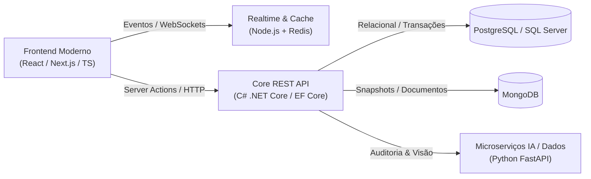

<!-- 

  

 -->

<h1 align="center">Olá, eu me chamo Vitor Luiz de Carvalho Gonçalves</h1>

  <b>Desenvolvedor Fullstack | C# .NET • React & Nextjs | vite • Cloud</b> 
  <i>Graduado em ADS | Ex-Professor e Coordenador Pedagógico em TI | Certificado Microsoft Azure AI-900</i>

  
  
  
  
  

---

Sou **Desenvolvedor Fullstack** com 4 anos de formação e vivência acadêmica na área e 2 anos de experiência profissional atuando como **professor de ensino técnico profissionalizante** e **coordenador pedagógico** em Desenvolvimento de Sistemas.

Essa trajetória profissional me proporcionou uma sólida base técnica e um diferencial estratégico: **comunicação assertiva, liderança técnica, didática e facilidade para aprender, estruturar e transmitir conceitos arquiteturais complexos**.

No desenvolvimento, meu foco é a criação de aplicações escaláveis, distribuídas, resilientes e de alta performance, unindo o ecossistema robusto do **C# (.NET / .NET Core)** a interfaces dinâmicas em **React / Nextjs | vite**, além de integração de microsserviços especializados com **Python (IA e automação)** e arquiteturas orientadas a eventos em tempo real.

- 🎯 **Objetivo:** Oportunidades como **Desenvolvedor Trainee, Júnior, Fullstack ou Analista Desenvolvedor**.
- 🎓 **Formação:** Graduado em **Análise e Desenvolvimento de Sistemas** (Faculdade Carlos Drummond de Andrade) e Técnico em Desenvolvimento de Sistemas (**SENAI Informática**).
- 📜 **Certificação:** **Microsoft Certified: Azure AI Fundamentals (AI-900)**.
- 📄 **Currículo Completo:** [Baixar / Visualizar PDF](./assets/VitorGoncalvesResume.pdf).
- 🗣️ **Idiomas:** Português (Nativo) e Inglês intermediário com compreensão avançada de leitura e escrita técnica.

---

## 🛠️ Tecnologias & Especialidades

### ⚡ Tecnologias de Maior Domínio

* **C# com .NET (.NET Core / .NET 10):**
  Construção de APIs RESTful escaláveis, microsserviços e Minimal APIs. Domínio de Programação Orientada a Objetos (POO), **Entity Framework Core**, arquiteturas em camadas (**MVC** e **Repository Pattern**), injeção de dependência e testes unitários automatizados com **xUnit**.

* **JavaScript & TypeScript com React e Next.js:**
  Desenvolvimento de interfaces modernas, performáticas e acessíveis. Utilização de **Next.js (App Router, Server Components e SSR)** para otimização de carregamento, segurança e SEO, integração com WebSockets no client, e prototipagem fiel com **Figma**.

* **Bancos de Dados Relacionais (SQL):**
  Modelagem de dados conceitual e lógica (Diagramas UML), criação de scripts SQL avançados, procedures, índices para performance, controle transacional rigoroso e migrações (Code-First / Database-First) em **PostgreSQL**, **Microsoft SQL Server** e **MySQL**.

* **Redis (Cache & Eventos):**
  Implementação de cache distribuído em memória de alta performance para reduzir latência de requisições frequentes, além de gerenciamento de sessões e mensageria **Pub/Sub** para fan-out de eventos em tempo real.

* **MongoDB (NoSQL Document Store):**
  Armazenamento flexível e otimizado para histórico de eventos, relatórios, snapshots de partidas finalizadas e dados de alta rotatividade não relacionais.

* **Python para Funcionalidades Específicas (IA & Dados):**
  Uso de Python em cenários que demandam bibliotecas especializadas: microsserviços com **FastAPI**, visão computacional e auditoria visual (**comparação de imagens com `imgcompare`**, OCR), análise de dados, engenharia de prompt e estabelecimento de contratos para geração de código com **LLMs agênticas**.

---

## 🧰 Tech Stack & Badges

  <b>Linguagens & Frameworks Principais</b> 
  
  
  
  
  
  
  
  
  

  <b>Bancos de Dados, Cache & Mensageria</b> 
  
  
  
  
  

  <b>DevOps, Cloud, Observabilidade & Testes</b> 
  
  
  
  
  
  
  

---

## 🌟 Projetos em Destaque

<table>
  <tr>
    <td width="50%" valign="top">
      <h3 align="center">🏆 <a href="https://github.com/vitorluuiz/Codex">Codex (Playcodex)</a></h3>
      

        <b>Plataforma Educacional Gamificada em Tempo Real</b> 
        <a href="https://playcodex.com.br">🌐 playcodex.com.br</a>
      

      

        Projeto idealizado a partir da experiência docente para acelerar o engajamento e quantificar o aprendizado prático de turmas de programação através de fases, partidas interativas e observabilidade do uso de IA generativa.
      

      <ul>
        <li><b>Web Frontend:</b> Next.js 15 (App Router / RSC) e React 19 para performance, segurança e SEO.</li>
        <li><b>Realtime Service:</b> Servidor WebSocket em Node.js com Redis para pub/sub e estado volátil das salas.</li>
        <li><b>Core REST API:</b> C# (.NET 10, Minimal APIs) com Entity Framework Core.</li>
        <li><b>Bancos de Dados:</b> PostgreSQL (fonte da verdade) e MongoDB (histórico de partidas encerradas).</li>
        <li><b>DevOps & Infra:</b> CI/CD com GitHub Actions, Docker Compose, Azure Cloud, Prometheus e Grafana.</li>
        <li><b>Qualidade:</b> Testes unitários com xUnit e políticas de contratos para arquiteturas agênticas.</li>
      </ul>
      

        
      

    </td>
    <td width="50%" valign="top">
      <h3 align="center">💳 <a href="https://github.com/vitorluuiz/DigiBank">DigiBank</a></h3>
      

        <b>Aplicação Bancária Fullstack & Estudo de Arquitetura</b>
      

      

        Aplicação recreativa completa voltada ao mercado financeiro, projetada com foco nas melhores práticas de consistência transacional, segurança de dados e alta performance de requisições.
      

      <ul>
        <li><b>Frontend Web:</b> Aplicação reativa construída com React, TypeScript e Vite, com fidelidade visual prototipada no Figma.</li>
        <li><b>API RESTful:</b> Desenvolvida em C# com .NET Core e Entity Framework Core, aplicando Repository Pattern e injeção de dependências.</li>
        <li><b>Banco de Dados:</b> Microsoft SQL Server estruturado para integridade referencial rigorosa.</li>
        <li><b>Estratégia de Cache:</b> Cache em memória nativo do ecossistema .NET para otimização de rotas críticas e consultas de alto volume.</li>
      </ul>
      

        
      

    </td>
  </tr>
</table>

### 🚀 Outros Projetos Relevantes

* 🚚 **[SAF — Sistema de Administração de Frotas](https://github.com/vitorluuiz/SAF):** Projeto desenvolvido com mentoria da empresa OK Entrega. Composto por painel Web em React, aplicativo mobile em React Native para operações de campo com OCR, **microserviço em Python (FastAPI + `imgcompare`)** para auditoria visual da frota e API RESTful em C# .NET com Entity Framework.
* 🤖 **[Kea](https://github.com/vitorluuiz/Kea):** Software CLI para simulação de interações de usuários em websites e aplicações em tempo real através de scripts determinísticos ou agentes orientados por LLMs.

## 📬 Vamos Conversar?

Estou disponível para novos desafios e colaborações técnicas!

  
  
  
  

